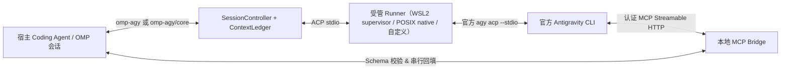

# omp-agy

基于 Bun 的官方 Antigravity CLI（`agy`）双向 **ACP + MCP** 桥接器，同时提供**零 OMP 依赖的独立核心库**与 **OMP `18.13.1` 扩展适配器**。

- **ACP（Agent Client Protocol）**：承载会话创建、模型/思维档位选择、流式文本与思考增量、原生实时 steering 及回合状态。
- **MCP（Model Context Protocol）**：将经 Schema 校验的工具请求交回宿主，由宿主按自身权限策略授权、执行并回填结果；桥接层不代执行项目工具、不伪造备用模型回退，也不代办非官方凭据提取。
- **双入口共享同一套协议内核**：
  - `omp-agy/core`（[core.ts](core.ts)）：独立 Bun 库，不依赖 `@oh-my-pi/*`，供任意自研 Coding Agent 直接接入。
  - `omp-agy`（[index.ts](index.ts)）：OMP `18.13.1` 扩展，负责消息投影、有效历史重建、工具来源证明、`ask` 提问、子代理路由、状态栏/配额展示与 `/agy*` 运维命令。
- **许可证**：[MIT](LICENSE)（仅适用于本仓库桥接代码，不包含官方 Antigravity CLI 及上游服务）。本项目不分发 `agy` 可执行文件。版本变更记录见 [CHANGELOG.md](CHANGELOG.md)。

---

## 架构概览



---

## 运行模式与安全边界

| 模式 | CLI 运行位置 | 适用平台与准入条件 | 隔离与回收边界 |
| :--- | :--- | :--- | :--- |
| **`wsl`**（默认） | Windows 上的专用 WSL2 发行版 `omp-agy-wsl`（非 root 用户 `agy`，默认 `/home/agy/.local/bin/agy`） | Windows + WSL2；复用发行版内已有个人登录态（`/home/agy/.gemini/antigravity-cli`），要求无 Windows 盘自动挂载 | 每次激活独立私有目录、独立高熵 Bearer Token、WSL 网关单接口绑定；Linux 监督器落盘世代清理收据，支持跨同次启动身份核验与 `/agy-reset` |
| **`native`**（显式启用） | 宿主 Bun 所在的 Linux / macOS 本机官方 `agy` | Linux / macOS；须显式传入可信 `cli` 与当前用户所有的现有 `accountDirectory` 绝对路径 | MCP 仅绑定 `127.0.0.1` loopback；每次激活创建 `0700` 临时配置树并符号链接账户目录；按独立进程组回收，不提供跨宿主崩溃后的持久收据恢复 |
| **自定义 Runner** | 由调用方自行管理的执行环境 | 独立核心库调用 `Agent.open({ bootstrap })` | 由自定义 `RunnerFactory` 提供 ACP 字节流、可达桥接地址与进程回收证明；切勿在命令行或普通日志中打印激活令牌 |

> **重要边界说明：**
> - **不做隐式回退**：Windows 默认仅运行专用 WSL 内的 `agy`，不内置 Windows 原生 `agy.exe` 后端；平台或参数不满足条件时直接报错失败。
> - **面向可信官方 CLI**：专用 WSL 与 `native` 私有目录用于隔离激活配置与减少工作区暴露，**不等同于抵御恶意代码或同 UID 进程的安全沙箱**。
> - **取消不等于回滚**：`/agy-stop`、信号取消或会话关闭只会撤销后续桥接能力并终止受管进程，不会撤销工具在宿主项目中已产生的写入或外部副作用。

---

## 快速开始

### 前置条件

1. 安装 **Bun `1.4.2`**（开发依赖安装：`bun install --frozen-lockfile`）。
2. 安装官方 Antigravity CLI 并完成[个人账号认证](https://antigravity.google/docs/install?tab=cli)。
   - Windows `wsl` 模式默认期望专用发行版 `omp-agy-wsl` 内存在用户 `agy`、`HOME=/home/agy`、可执行文件 `/home/agy/.local/bin/agy` 及已登录目录 `/home/agy/.gemini/antigravity-cli`（权限 `0600` 或 `0400`）。扩展不会在启动时自动安装发行版、搜索 `PATH` 或修改全局 `.wslconfig`。

### 方式一：在 OMP `18.13.1` 中加载

**Windows（默认专用 WSL2 模式）：**

```sh
# 在仓库目录按需加载（默认加载时不启动 WSL）
omp -e ./index.ts
```

**Linux / macOS（显式启用 `native` 模式）：**

```sh
export OMP_AGY_RUNNER_MODE=native
export OMP_AGY_CLI="$HOME/.local/bin/agy"                        # 已安装官方 CLI 的绝对路径
export OMP_AGY_ACCOUNT_DIRECTORY="$HOME/.gemini/antigravity-cli"  # 已登录账户目录（非单个 token 文件）
omp -e ./index.ts
```

如需在任意工作目录自动加载，可在个人 OMP 配置（如 `~/.omp/agent/config.yml`）的 `extensions` 列表中显式填入本仓库 `index.ts` 的绝对路径。扩展自身不会自动改写 OMP 核心或默认模型角色。

### 方式二：作为独立库接入自研 Coding Agent（`omp-agy/core`）

`omp-agy/core` 不加载任何 `@oh-my-pi/*` 包。先在本仓库打包，再安装到目标 Bun 项目中：

```sh
bun pm pack --ignore-scripts
# 在目标 Bun 项目中安装生成的 tarball：
bun add /path/to/omp-agy-0.1.0.tgz
```

> **TypeScript 编译提示：** 本包直接导出 `.ts` 源码入口（`"./core": "./core.ts"`）。若宿主项目运行 `tsc --noEmit`，请在宿主 `tsconfig.json` 中启用 `"moduleResolution": "Bundler"`、`"allowImportingTsExtensions": true` 与 `"noEmit": true`（`bun init` 默认已启用）。

最小接入流程（完整可运行代码见 [examples/standalone.ts](examples/standalone.ts)）：

```ts
import { Agent } from "omp-agy/core";

const agent = await Agent.open({
  // 默认使用 Windows WSL runner；Linux/macOS 可传 { runner: { mode: "native", cli, accountDirectory } }
  tools: [
    {
      name: "greet",
      description: "Generate a greeting",
      parameters: {
        type: "object",
        properties: { name: { type: "string", maxLength: 80 } },
        required: ["name"],
        additionalProperties: false,
      },
    },
  ],
  executeTool(call, signal) {
    signal.throwIfAborted();
    return {
      source: "content",
      isError: false,
      content: [{ type: "text", text: `Hello, ${String(call.arguments.name)}!` }],
    };
  },
});

try {
  // 如需指定模型：await agent.selectModel("gemini-4-hydrogen");
  agent.send("Call greet with the name Ada, then summarize the result.");
  for await (const update of agent.receive()) {
    if (update.type === "text") process.stdout.write(update.text);
  }
} finally {
  await agent.close();
}
```

接入要点：
1. **单实例单会话**：一个 `Agent` 实例对应一次激活与单飞回合，请勿在并发宿主会话间共享同一个实例。
2. **工具执行归属宿主**：仅注册宿主实际支持的工具；既可通过 `executeTool` 自动回填，也可省略 `executeTool` 并在 `receive()` 收到 `{ type: "tool_call" }` 时调用 `await agent.complete(call.id, result)` 完成原请求（切勿把工具结果拼成新 prompt 重发）。
3. **显式回收与禁止盲目重放**：始终在 `finally` 中 `await agent.close()`；报错或取消后可能已有外部副作用，不应自动重放上一轮任务。

---

## 在 OMP 中使用

### 模型发现与角色边界

- **按需发现（默认）**：默认 `OMP_AGY_DISCOVERY=ondemand`，启动 OMP 时不拉起 WSL；在会话内运行 `/agy-discover` 或 `/agy <精确模型ID>` 时才执行实时 ACP 发现并立即回收发现进程（不发起文本生成）。
- **启动期发现（可选）**：若需通过命令行 `omp --model omp-agy/<模型ID>` 启动或将默认角色绑定到 AGY，可设置 `OMP_AGY_DISCOVERY=startup`。模型列表完全取决于当前账号与实时 CLI，发现成功不代表上游配额一定允许生成。
- **上下文窗口**：发现时按当前 CLI 版本和精确模型 ID，在独立空会话中观察 AGY 报告的会话窗口。能确认的读数优先于旧版本表；同尺寸、迟到或缺失的通知不能单独证明模型容量。没有可靠读数时仅使用同版本参考表、显式本地预算或默认 `400000`，不逐次调用弹警告。AGY 更新或账号新增模型后，可在空闲时用 `/agy-discover` 刷新，无需修改模型表。显式 `OMP_AGY_CONTEXT_WINDOW` 仍是本地预算上限。
- **OMP 18.13.1 角色边界**：主会话与拥有独立扩展会话的 `task` 子代理均可正常使用 `omp-agy`；但 OMP `18.13.1` 内置 `advisor` 使用未绑定的独立 provider 会话 ID，直接设置 `modelRoles.advisor` 不会生效（需要独立评审时请使用 `task` 子代理）。支持多模态图片输入不等同于支持图像生成、语音或内置联网搜索。

### 扩展斜杠命令

| 命令 | 说明 |
| :--- | :--- |
| `/agy-discover` | 从真实 ACP 会话刷新当前配置的实时模型目录并立即清理，不生成文本。 |
| `/agy <精确模型ID>` | 实时刷新目录并将当前会话切换到指定模型 ID，不修改全局默认角色。 |
| `/agy-status` | 查看去敏后的激活世代、进程/清理状态、pending 工具计数与当前上下文用量。 |
| `/agy-profile custom-clean\|default-agy\|omp-system` | 空闲时切换当前扩展会话的 Prompt Profile（下次显式输入按有效历史重建）：<br>• `custom-clean`（默认）：禁用默认自定义组件，不转发 OMP 系统提示词；<br>• `default-agy`：保留官方默认代理行为；<br>• `omp-system`：**显式开启**后将 OMP 系统提示词（可能含项目规则、记忆与扩展指令）写入当次私有主代理配置，请注意隐私边界。 |
| `/agy-login` | **仅限专用 WSL、本地主 TUI 且完全空闲时**：在同一终端前台拉起官方 CLI 手动登录流程以替换 `omp-agy-wsl` 默认账号。 |
| `/agy-stop` | 立即中止当前请求、撤销 MCP 能力并等待 Linux 清理确认；不回滚已执行的工具副作用。 |
| `/agy-reset` | **仅限 WSL 且空闲时**：核查 `boot_id`、PID 启动时间与持久收据，安全回收可证明已停止的残留注册表项，绝不按进程名盲杀。 |
| `/agy-debug on [目录]` \| `content [目录]` \| `status` \| `off` | 开启有界元数据跟踪（`on`）或敏感正文跟踪（`content`）、查看状态或关闭落盘。默认关闭；默认目录 `.omp/agy-debug/` 已在本仓库 `.gitignore` 忽略，自定义路径请自行妥善保护。 |

### 账号切换、配额、思维档位与实时 Steering

- **切换 WSL 账号（`/agy-login`）**：先确认所有使用 `omp-agy-wsl` 的窗口均已空闲。进入原生 AGY 界面后输入 `/logout`（若 CLI 退出可按提示按 `r` 重新打开），在浏览器登录目标账号并将授权码**仅粘贴回原生 AGY 提示框（切勿粘贴进 OMP 聊天框）**。注意 `/logout` 后即使取消新登录也不会恢复旧凭据。完成后退出原生 CLI，回到 OMP 执行 `/agy-discover`；若不希望旧对话历史发往新账号，请执行 `/new`。`native` 模式请直接在宿主机官方 `agy` 中管理账号。
- **原生思维档位（Thinking Efforts）**：档位列表取自各模型实时公开的 ACP `thought_level`（例如 Hydrogen 支持 `low` / `medium` / `high` / `xhigh`），通过 OMP 原生思维选择器切换，并在空闲边界经 `session/set_config_option` 确认后才发请求；工具回填途中改档会给出延后提示而不会打断正在执行的原工具调用。
- **双口径上下文与官方配额**：状态栏同时展示 `AGY ctx <已用>/<原生窗口> native` 与 `OMP <本地预算>`。WSL 模式下配额浮窗与 OMP 原生 `/usage` 均读取官方非生成式 `/usage` 输出的账户组 `5h` / `weekly` 剩余比例与重置时间，不做模型归属猜测；状态栏浮窗新鲜度上限为 60 秒，OMP `/usage` 面板带有自身分钟级缓存，请以报告附带的采样时间戳为准。
- **历史图片连续性与未知 Steering 隔离**：上下文账本兼容 OMP 5 图上限裁剪（覆盖用户消息、开发者消息、工具结果与压缩摘要帧），不会因正常老图淘汰而反复重启会话。流式生成期间的原生 steering 若在收到官方回显或成功响应前中断/超时，扩展会持久隔离该未知输入并停止当前激活——若 OMP 将该条输入恢复到待发队列，请先手动清除该待发项，再发送新的显式输入。

---

## 环境变量参考

> 注意：`omp-agy/core` 独立库入口仅使用调用方显式传入的配置对象，不会隐式读取 `OMP_AGY_*` 环境变量。

| 环境变量 | 默认值 / 适用范围 | 说明 |
| :--- | :--- | :--- |
| `OMP_AGY_RUNNER_MODE` | `wsl`（可选 `native`） | 选择运行后端；不做跨模式隐式回退。 |
| `OMP_AGY_DISCOVERY` | `ondemand`（可选 `startup`） | 模型发现时机；`startup` 在扩展加载时执行一次实时发现。 |
| `OMP_AGY_PROFILE` | `custom-clean` | 初始 Prompt Profile：`custom-clean`、`default-agy` 或 `omp-system`。 |
| `OMP_AGY_MODELS` | 未设置（全部实时模型） | 逗号分隔的模型 ID 白名单，仅取实时公开目录的子集。 |
| `OMP_AGY_INSTRUCTIONS` | 未设置 | 显式附加给 AGY 的指令文本。 |
| `OMP_AGY_CONTEXT_WINDOW` | 未设置（未知模型默认 `400000`） | 正安全整数本地预算（空串视为未设置）；已知模型上限更小时自动按较小值夹紧。 |
| `OMP_AGY_MAX_TOKENS` | `8192` | 暴露给宿主的单次输出 token 预算正安全整数。 |
| `OMP_AGY_STEERING_CONFIRMATION_MS` | `30000` | 原生 steering 等待官方会话文本/思考进展的空闲确认窗口（毫秒）。 |
| `OMP_AGY_DEBUG_DIR` / `OMP_AGY_DEBUG_MODE` | 未设置 / `metadata` | 设置目录后在启动时开启有界 JSONL 跟踪；模式可选 `metadata` 或 `content`。 |
| `OMP_AGY_CLI` | WSL: `/home/agy/.local/bin/agy` | 官方 `agy` 可执行文件的 Linux/macOS 绝对路径（`native` 模式必填）。 |
| `OMP_AGY_ACCOUNT_DIRECTORY` | WSL: `/home/agy/.gemini/antigravity-cli` | 已认证账户目录绝对路径（`native` 模式必填；非 token 单文件路径）。 |
| `OMP_AGY_WSL_PATH` / `OMP_AGY_WSL_DISTRIBUTION` / `OMP_AGY_WSL_USER` | `C:\Windows\System32\wsl.exe` / `omp-agy-wsl` / `agy` | 仅 `wsl` 模式可用；`native` 模式传入 WSL/HOME/XDG 覆盖项会直接报错拒绝。 |
| `OMP_AGY_HOME` / `OMP_AGY_XDG_{CONFIG,CACHE,DATA}_HOME` | `/home/agy` 及对应 `.config` / `.cache` / `.local/share` | 仅 `wsl` 模式可用的 Linux 目录覆盖项。 |
| `OMP_AGY_STARTUP_TIMEOUT_MS` / `OMP_AGY_CLEANUP_TIMEOUT_MS` / `OMP_AGY_STDERR_LIMIT_BYTES` | `30000` / `15000` / `65536` | 启动超时、清理确认超时（毫秒）与诊断尾缓冲字节上限（均须 `>= 1024`）。 |

---

## 验证与打包分发

```sh
# 1. 类型检查
bun run check

# 2. 运行单元与集成回归套件（Linux CI 无账号回归；Windows 含专用 WSL 监督器 fixture）
bun test --timeout 20000

# 3. 打包并校验独立无 OMP 消费者安装与 omp-agy/core 加载
bun scripts/check-package.ts

# 4. 生成本地分发包（omp-agy-0.1.0.tgz）
bun pm pack --ignore-scripts
```

- **真机手动冒烟（按需执行）**：`bun scripts/activation-smoke.ts --out .acceptance/new-run` 需要本机已安装 OMP、专用 WSL 及已登录账号，并会发起一次真实只读模型调用；日常自动化回归不运行该脚本。
- **验证范围声明**：专用 WSL + Hydrogen 下的真实工具回填、多图连续读取、思维档位切换与退出清理已完成实机观察；真实 CLI 同时 45 个 pending 工具请求、各平台/账号下的 `native` 真机表现及完整 A01–A12 矩阵仍保留明确证据边界，不作过度承诺。历史本机验收轨迹（`.acceptance/`）不随源码或包分发。
- **延伸文档**：完整设计合同与验收矩阵见 [docs/omp-agy-v2.2-final-proposal.md](docs/omp-agy-v2.2-final-proposal.md)，统一术语表见 [GLOSSARY.md](GLOSSARY.md)，版本变更记录见 [CHANGELOG.md](CHANGELOG.md)。
