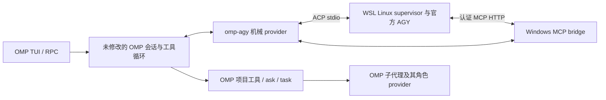

# omp-agy v2.2 最终候选方案

> **当前运行边界（优先于下文）**：下文记录 v2.2 的 Windows/WSL 基线与当时验收。后续加入的显式 native runner（Linux/macOS）和独立 `core.ts` 入口取代了其中「仅限 Windows/WSL」的限制。OMP 默认仍为专用 WSL runner、按需发现，不做隐式 fallback；native 仅在显式选择时启用。见 [使用说明](../README.md)。下文的历史证据不代表新路径已验收。

日期：2026-11-17。状态：**产品取舍与最终复审修正已确认；已完成运行时实施和本次 A01–A12 验收记录。用户明确选择保留当前运行策略及分层证据，A04 的真实 CLI 45 pending未观测项不改写为通过，因此不宣告全矩阵通过。** 本文取代旧核心路由设计作为当前实施合同；本次批准的结构化结果兼容例外见§5.2。历史证据保留原范围，不以新增实现倒写旧结论。

输入：本地归档的 v2.1 原提案、逐项再审计、保存的探针与本次离线 OMP 观察。原报告仅在本地保留，不随发布分发。

## 1. 已确认的决策：本轮不再悬置

| ID | 用户确认的选择 | 具体含义 |
| --- | --- | --- |
| D01 | 明确 CLI 路径，不折腾 PATH | 运行使用固定 WSL 发行版、用户与 Linux CLI 绝对路径，可显式覆盖；不搜索到别的 binary 后暗切换。Windows 已安装路径仅作历史诊断记录。 |
| D02 | 不需要逐工具人工审批，ask 除外 | 不额外实现 prompt-writes/确认弹窗；沿用 OMP 已有工具授权、deny、hooks 与执行策略，不强制覆盖为 yolo。ask 是提问而非工具审批。 |
| D03 | 只交付 WSL2 runner | 专用 `omp-agy-wsl`，不实现 Windows-local、Job Object/Junction runner，不自动降级；不修改默认发行版或全局 `.wslconfig`。 |
| D04 | 完整宿主体验优先 | 以 provider 收到的、已由 OMP 转换的上下文为输入，不追求编辑器字节级原文。接受消息中的文件引用、摘要、提醒及宿主生成上下文。 |
| D05 | 默认 custom-clean，保留显式 default-agy | 自定义精简 profile 默认；官方默认 Agent profile 独立验证，不把两者混称“原生默认”。 |
| D06 | 可信 CLI，而非恶意代码沙箱 | WSL 为减少宿主项目暴露的专用运行环境；不承诺抵抗同用户进程、恶意代码、提权或虚拟化漏洞。 |
| D07 | 子代理由 OMP 完成 | 不实现 AGY 原生 child 编排；保留 OMP 的 task/agent 调度、权限与结果。 |
| D08 | 子代理沿用 OMP 角色模型及 fallback | 不强制继承父 AGY 模型；整棵任务树不再保证所有模型请求都经 ACP。选择 AGY provider 的子会话才创建自己的 ACP 激活。 |
| D09 | 子代理问题交父代理 | headless 子代理回传问题/阻塞，父代理使用自身 ask；不新建跨 child 的共享 UI。 |
| D10 | 允许按当前有效历史重建 | branch、compact、resume 或故障后的新 AGY 上下文可由 OMP 当前有效历史/摘要播种；历史工具调用只作记录，不由桥重新派发。 |
| D11 | ask 沿用 OMP 当前策略 | 包括其超时、推荐项处理和取消；不承诺无限等待，不擅改全局 ask 设置。 |
| D12 | 不修改 OMP 核心；steering 按阶段限定 | provider 流式响应期间同一 ACP 会话原生实时交付；工具/ask 期间沿用宿主队列/中断策略，到边界再交付，不承诺即时。禁止用取消重建伪装实时 steering。 |

D04 的内容边界：`custom-clean` 与 `default-agy` **不发送独立 `context.systemPrompt` 字段，但不保证 `messages` 中完全没有 OMP 指令或记忆。** 后续用户要求增加 `omp-system`，仅该显式选项将当前调用的系统提示词用于 AGY 自定义主代理（见 §4.1）。所有模式都不把 user-role 消息认定为人类输入原文，且不靠正则删除 reminder。

2026-11-17 用户已明确授权按现有 v2.2 方案开始代码实施、完成 A01–A12；仅使用专用 WSL 目标和现有登录态，不包含重新登录、Windows agy 或 OMP 核心修改。已有零生成结论不重复探测；变更后的集成验收另行记录。

2026-11-17 实施审计后，用户明确选择**默认按需发现**：普通扩展加载不启动 WSL；`/agy <精确模型ID>` 实时发现并切换当前会话，`/agy-discover` 显式刷新。只有 `OMP_AGY_DISCOVERY=startup` 显式启用启动期发现，供 CLI/已有 AGY 默认角色解析。不使用持久模型缓存；同进程 prepared 工厂允许重注册成功实时发现所得的模型元数据，不共享 activation/能力/凭证。配置特定目录不保证其他配置可用，执行前仍由该会话真实 ACP 验证。此调整只改变发现时机，不修改 D04、角色路由或 §4.3 的模型切换重建规则。

## 2. 产品结构与范围

- TypeScript/Bun 的标准 OMP 扩展，使用 `registerProvider` / `streamSimple`；不暴露公网模型 API、不依赖 RPA 运行时、不实现反向 `agy_prompt` 工具。
- 在选择 AGY provider 的会话中，官方 CLI 负责模型连接和基于工具结果继续推理；适配层只做协议、状态和数据转换，不增加另一模型转述。
- OMP 保有项目 root、工具实现、执行策略、UI、日志、子代理和宿主上下文管理。工具实际通过 OMP 原循环执行，不直接调用绕过 hooks 的工具函数。
- ACP client 不提供文件/终端执行能力。Windows 项目不挂载进 Linux；真实项目路径作为工具参数由 Windows OMP 处理，不能转换为 `/mnt/c` 来让 CLI 执行。
- 初次发行的功能验收包括两个 profile、宿主上下文重建、OMP 子代理、ask 和 D12 的 steering。不是只通一次 read 就交付。
- 不包含：Windows-local runner、原生 AGY 子代理管理、模型账号池、TLS/UA 仿造、上游流量拦截、额外模型重试或绕过厂商模型可用性限制。

### 2.1 小范围实现单元

| 单元 | 职责 | 不承担 |
| --- | --- | --- |
| extension/provider | 注册模型、接入宿主 context/事件、输出原生 AssistantMessage 事件 | 不重新实现 OMP 输入框或工具 executor |
| context ledger | 当前有效上下文投影、连续性检查、已交付输入/工具结果记账 | 不保存原始 OAuth，不声称恢复 AGY 隐藏思考 |
| ACP session controller | 连接、会话、prompt flights、单一事件消费者、steering、终结 | 不把单次 provider 调用当整个 agent 生命周期 |
| MCP bridge | 认证、目录、schema、pending 队列、结果编码 | 不按通知/文本伪调用执行工具 |
| WSL runner/supervisor | 显式启动、私有运行目录、stdio、Linux 进程清理 | 不实现通用多平台 IsolationDriver |

这些是责任边界，不是要求预先建立五套框架或另一个 RPC 系统。实现可合并小文件，但必须保持生命周期归属清楚。

## 3. WSL、身份与网络

### 3.1 固定运行配置

| 项目 | 初始明确值 |
| --- | --- |
| Windows 启动器 | `C:\Windows\System32\wsl.exe` |
| 发行版 | `omp-agy-wsl` |
| Linux 用户 | `agy`，不能是 root |
| Linux 官方 CLI | `/home/agy/.local/bin/agy`，保存证据报告版本 1.5.9 |
| Windows 官方 CLI（历史） | 安装在用户的本地应用数据目录下；不作为运行 fallback |
| 传输 | ACP stdio；私有配置注册的 MCP HTTP |

唯一运行目标为 `omp-agy-wsl` / `agy` / `/home/agy/.local/bin/agy`（D01/D03）；Windows `agy.exe` 仅为历史证据。启动参数使用参数数组，不以拼接 shell 命令承载用户内容，也不把含 shell 变量的 `bash -c` 字符串放进 `wsl.exe` 命令行。路径或发行版不符直接诊断。运行时核对实际 binary/version，不能以文件夹名当版本保证。

已保存的 `wsl.conf` 包含 automount=false、interop=false、appendWindowsPath=false 和默认用户 agy。但 **配置文字不是生效证明**：保存的 P164 显示 WSLInterop 仍 enabled；P162 证明一次 DrvFs mount 被拒，`cmd.exe` 不在 PATH 不证明绝对路径也不能执行。

实施前检查并记录实际身份/组/权限、相关 mounts、可访问共享目录、interop 行为与网络。按 D06 处理为可信软件运行环境；发现意外 Windows 项目挂载或错误运行用户应拒绝启动，不把所有 WSL mounts 一概称为“无宿主接触”。不使用全局 `wsl --shutdown` 干扰 docker-desktop。

### 3.2 稳定登录态与临时激活目录分离

- **默认账户来源明确**：复用专用发行版内现有用户 `agy` 的 `HOME=/home/agy` 与 `/home/agy/.gemini/antigravity-cli`，不是每次创建空 HOME，也不默默读 Windows 账号。用户 2026-11-17 报告默认 token 位于 `/home/agy/.gemini/antigravity-cli/antigravity-oauth-token`，owner 为 `agy`、mode 为 `0600`。其他显式账户须明确其稳定账户根。
- **账户环境稳定、激活配置临时**：官方登录与 ACP 启动使用同一稳定 HOME 和明确、稳定的 XDG 目录；显式设置隔离且不可达的 `DBUS_SESSION_BUS_ADDRESS`，不继承宿主会话总线。每个激活使用独立 runtime workspace、`--gemini-dir`、MCP bearer 和日志去敏标识，配置以 owner-only 权限写入。
- 私有 `--gemini-dir` 中以目录 symlink 关联**整个**持久 `antigravity-cli` app-data 目录，不只链接单个 token；不复制凭证、不自行 refresh、不要求重新登录。用户报告已观察到该 alias 成功复用现有登录。清理只 unlink 临时链接和删除激活自身目录，不跟随链接递归删除持久目标。
- 已观察到的登录与 alias 复用不等于 refresh/原子更新及共享账户并发状态已验证；这些仍纳入验收。若 CLI 实际不使用指定存储路径，须明确修正配置，不能暗切账户。
- 同一 Linux UID 下这些目录不是抵抗 AGY 本身或同 UID 进程的凭证隔离。多个 AGY 子会话各有运行配置；若官方共享账户状态不支持安全并发，应报告并另行裁定是否串行或增加账户配置，不能悄悄共享出错。

### 3.3 WSL → Windows MCP 是私有接口网络，不是 loopback

冷启动顺序固定为：发行版处于 Stopped 时，先经 `wsl.exe` 启动 WSL runner/supervisor bootstrap → 从已启动的目标发行版取得**当前 eth0 默认路由的 gateway 与 source IP**，核对 Windows WSL 接口 → Windows `omp.exe` 宿主的 `Bun.serve` 绑定该接口的临时端口 → 写好私有 MCP config → 才启动 ACP/CLI 连接。不得在发行版尚未启动时要求路由已存在，不使用缓存/硬编码 IP，也不让 ACP 先于服务和配置就绪。默认 NAT 下仅绑定该接口，**不绑定 `0.0.0.0`**；历史观测中的 gateway 地址不是运行配置常量。历史 GET 基线之外，用户本次已报告真实 tools/list 可达（§9.1），不等于完整工具调用闭环通过。

认证和暴露约束：
1. 每次激活生成新高熵 token。实际 MCP `initialize`、`tools/list`、`tools/call` 等请求必须检查 token、允许的 Host、精确路径、方法、body 大小/结构和 Origin；意外浏览器 Origin 拒绝。源地址限制仅为辅助，不替代 token。
2. 目标 `agy 1.5.9` / `antigravity-client 1.0.0` 的用户报告中，`session/new` 共观察到 9 个 HTTP 请求，含未认证 `GET /.well-known/oauth-protected-resource*` 和 initialize 前的 `POST server/discover`；不据此假定后者携带 bearer。仅对明确的 OAuth protected-resource well-known discovery GET 路径返回无数据的 `404`，保留 Host、Origin、精确路径、方法与 body 大小门禁，不因该预期探测判定激活失败。
3. 另一窄例外仅处理 MCP endpoint 上、initialize 前、JSON-RPC method **恰为 `server/discover`** 的 POST probe：无论有无 Authorization，仍限制 Host、Origin、精确路径、方法、body 大小/结构，原样保留合法请求 id，返回无副作用的 `-32601 Method not found`，保持 transport/activation 开放。这不是成功的已认证 MCP initialization，不创建 MCP session/catalog/pending 状态、不返回工具或凭证、绝不派发工具。两种探测例外均不放宽实际 `initialize`、`tools/list`、`tools/call` 等 MCP 请求的认证，也不扩展为任意未知方法的匿名访问。
4. 实际 MCP 请求缺失/错误 token 时拒绝**该请求**，不能由任意外来请求无条件关闭整个激活。已确认属于本激活 CLI 自身的认证/配置失败仍停止激活并清理；不能把 discovery 的预期 404/-32601 当作这种失败。
5. token 只放私有 config 的 Authorization header，不放 URL、模型消息或普通日志；每个独立会话有独立 endpoint/catalog/pending registry。
6. 在 Linux 子进程现有 NO_PROXY/no_proxy 中追加实际 gateway 与所用 loopback，保留原条目。须验证 CLI 网络栈确实旁路该地址；环境变量不等于已防止代理转发。
7. 绑定失败、路由改变或已确认的自身认证/配置失效则关闭激活并清理，不改防火墙为宽泛放行、不自动切镜像网络。用户现有 mirrored 环境只有通过真实连通性验收后才可使用 loopback。
8. 明文 HTTP 不抵抗可观察该链路的本地攻击者或已攻陷同用户进程；D06 不把这些列为已解决威胁。若未来要求该边界，需要单独选择加密或本地 transport，而非只加 IP 白名单。

MCP config 保持单一规范写法：`mcpServers.omp_agy_bridge.serverUrl`、`headers.Authorization`、`timeoutSeconds:-1`、以**发布别名**为 key 的 `tools.<alias>.eager:true`。用户已报告 `mcp_config.json` 的 `serverUrl` 与 `url` 两种拼写均到达 tools/list；实现仍选现有 `serverUrl`，不为兼容同时重复注册。schema 由 tools/list 返回，不塞进 eager 配置，`session/new.mcpServers` 也不重复注册同一服务。`-1` 仅关闭该 CLI 文档所述的 MCP timeout，不保证整个 HTTP/SDK/client transport 永不超时或 idle disconnect，也不覆盖 OMP ask、命令、session、网络或用户取消。

**AGY 1.5.10 就绪兼容性修正：** `session/new` 可能早于本激活的已认证 `tools/list` 完成。进入 provider 可用态前，必须有界等待真实 MCP 初始化与目录读取完成；使用活动通知与状态复核防止丢失唤醒，不能把瞬时未就绪直接视为永久认证失败，也不能仅凭 `session/new` 成功放行。期限使用既有 `runner.startupTimeoutMs`；取消、停止、致命错误、ACP 关闭或 producer 退出均中止等待并清理。此等待不提交模型请求，不重试或重放。

### 3.4 Linux producer 的回收

`wsl.exe` 只是启动器，终止 Windows PID 不算确认 Linux worker 已停。使用本项目拥有的 Linux supervisor，不额外安装 supervisor 运行时：
- 使用已报告存在的 `/usr/bin/setsid` 与 `/usr/bin/bash`（或可用的 sh）建立独立 session/process group，持有真实 child PID、PGID、generation 和 stdio；不依赖本发行版缺少的 python3/node。
- bootstrap/脚本 staging 使用 argv 数组与 `bash -s` 的 stdin，不在 `wsl.exe` 命令行中嵌含变量的 `bash -c` 字符串。脚本输入与 ACP stdin 分离；需要时先 stage 归本激活所有的脚本，完成启动资源准备后再启动长驻 ACP，不能把协议输入当 shell 脚本消费。
- ACP 启动后 stdout 专属 ACP，bootstrap 诊断不混入协议流；stderr **异步、有界地持续消费**，不能阻塞式同步读到 EOF 后才处理 stdout/退出。用户报告 task-180 自身 awk 解析及同步 stderr 读取挂起，不能重演这种宿主读取死锁或归罪 CLI。
- 正常关闭、IPC EOF、父控制器失联均触发回收；先撤销 Windows MCP 能力，再请求 ACP cancel/close；有界等待后对该 Linux group TERM，再 KILL，wait/reap 并记录已知 workers 的退出结果。
- 不仅以主 PID 退出判成功；对真实 `--process-per-session` worker 做崩溃/取消测试。若目标版本有脱离 group 的 worker，必须增加经验证的 cgroup/supervisor 归属机制后才能通过清理验收，不用扫描所有同名进程乱杀，也不日常终止整个发行版。
- 未确认清理时显示 cleanup_failed；旧 endpoint 保持吊销，不启动另一个 producer 假装已停。Linux 组不是恶意进程不可逃逸的 sandbox；这与 D06 一致。
- 实施审计后的清理归属：Linux 在确认退出后原子保存 generation 绑定的持久清理收据，并自行删除 activation 目录，不能依赖宿主 shutdown 回调存活到删除步骤。宿主回调完成与 Linux 实际清理分别验证；审计必须逐条配对同 callId/generation 的 stop_before/stop_after，并覆盖真正开始 prompt 的 generation，发现阶段的成功收据不得替代会话收据。
- 恢复只回收经 boot ID、owner/worker 身份验证可证明已停止的激活。跨 Linux 重启能证明旧进程已不存在；同次启动身份仍不明时继续隔离并报告路径。保留原身份/故障记录，不杀同名进程、不终止发行版、不以恢复名义重放用户任务。曾更换 PGID 本身不等于仍有残留，但所有已知 worker 仍须确认退出。
- 在严格退出验收再次暴露宿主 2 秒窗口与原 3 秒 TERM 宽限冲突后，用户明确选择将 TERM 宽限缩短为 500ms，再执行身份限定的 KILL 与退出验证。此选择可能更早打断 CLI 内部尚未完成的写入，不保证任意负载下宿主回调都能在 2 秒内完成；不得提前伪造 stopped，Linux 独立最终清理和严格收据配对要求不变。

## 4. Profile、模型与宿主上下文

### 4.1 提示词 profile

| Profile | 配置与目的 | 必须保留的限定 |
| --- | --- | --- |
| custom-clean（默认） | 私有 agent，`excludeDefaultComponents:true`、`tools:[]`；用户明确选择的指令经官方支持的 agent/append 机制提供；请求 `--include-default-customizations=false`。 | 是自定义精简 AGY，不是完整官方默认 prompt；不能由 flag 推出零残余工具/插件/hooks。必须验证私有 agent 能被发现。 |
| default-agy（显式） | 保留官方默认 Agent 与系统组件，不设 excludeDefaultComponents；仍使用专用运行配置与受审定 MCP。 | `include-default-customizations=false` 可能改变默认 customization 体验；记录实际生效范围，不称与裸官方客户端完全一致。 |
| omp-system（显式） | 复用 `custom-clean` 的私有主代理机制，以本次 OMP 调用的系统提示词为正文，追加工具路由说明；去掉中英文逗号后的空格。 | 只覆盖可配置的主代理指令，不改变 Google 内容过滤；独立提示词可能包含项目规则、记忆及扩展指令。目录发现使用不含该正文的 clean agent。 |

前两者仍不转发 `context.systemPrompt`；`omp-system` 不用 ACP append 模拟覆盖，也不把系统提示词当成用户消息。模型从真实 ACP 会话发现并按配置限制；如实发送 clientInfo，不模仿其他客户端。

实际发出的 RequestPermission：校验 live session、结构化工具身份和已注册 bridge tool，选择**实际给出的** allow-once option ID；非 bridge 操作按已审定 profile 策略拒绝或取消，不伪造 option。但已授权或不询问的 native 行为不会被该 callback 拦截。运行配置应禁用不需要的原生委托/项目工具；未证明的限制不得宣传为强制拦截。

AGY 自身 runtime/cache 活动与 OMP 项目执行分开。若某 profile 依赖 CLI 本地项目操作才工作，不把 Linux staging 成果伪报成 Windows 项目修改；该 profile 的项目工具适配验收失败。原生 AGY descendants 不作为用户功能提供，也不以它们替代 OMP task。

ACP `available_commands_update` 一律忽略，不注册到 OMP 命令面板、不转成 OMP/native 操作。用户报告即使 custom-clean 加 `--include-default-customizations=false`，仍收到 `plan` / `grill-me` / `learn`；因此 flags 不是“没有 native 操作”的证明。`usage_update` 是独立的 usage 记账通知，不是命令目录；其实际字段与语义以目标版本为准，不从命令隔离规则推断它已完整适配。

#### 4.1.1 上下文预算（2026-11-18 后续确认）

模型可用性以真实 ACP 目录为准，容量参考表不能创建不存在的模型。在独立的零生成发现会话中，优先用当前 CLI、当前配置及精确模型 ID 可归属的实测会话窗口；不将邻近选模的无标签使用量通知直接归给新模型。取不到时可用相同版本和模型的参考表，不把公开规格、其他版本的窗口或回退预算冒充原生容量。

`OMP_AGY_CONTEXT_WINDOW` 是可选正安全整数。已知上限时，显式预算取 `min(预算, 上限)`；未设置时使用该模型的参考窗口。本机已设为 **400000（40 万，不是 40k）**。新增模型或未知 CLI 版本缺少容量参考时，不因缺表拒绝，而采用显式预算或默认 400000 并明确标记“上限未知、本地预算”；不能借用另一 CLI 版本的上限冒称已验证。获得可靠上限后取较小值，不通过生成失败后自动重试。输出预算仍为 8192。

调用方 registry 的原始窗口必须是正安全整数且不超过当前有效预算；空值、非法值和过大的旧值在提交 prompt／回填工具结果前拒绝并要求刷新，不能经取小值函数掩盖旧 registry。预算拒绝不制造脏执行记录，也不清除已有防重放状态。参考表与零生成验证范围记录于本地实施审计 §5.8。

### 4.2 输入与 history 的确定规则

**唯一宿主输入基线是 provider 收到的有效 context，而不是 input hook 旁路快照。** OMP 已负责 transformContext、convertToLlm 和 provider normalization；桥不重新运行这些转换，以免重复包装。

- 按明确编码保留消息内容、角色与必要工具身份。`omp-system` 在新激活时使用当前调用自身的独立系统提示词；其他模式忽略该字段。仅独立提示词变化时不打断活跃 MCP 回填，待空闲且有新输入再应用。OMP developer/custom/summary 内容若已进入 messages，仍按 D04 接受。
- 不正则清洗 `<system-reminder>`，不删除用户同形文字，不保证宿主隐藏信息绝不出站。不发送与 context 无关的内部调试对象、认证材料或 UI renderer 状态。
- 新激活：将当前有效历史编码为带角色/工具结果身份的 ACP 文本与受支持内容块；历史工具调用明确为已发生记录，不转换成 live MCP 请求。最新待处理输入单独标明，避免把旧任务当新的执行指令。
- 连续激活：保存已接受的语义前缀/checkpoint，比较实际内容与身份，不只用 syncedCount。宿主时间戳等非语义字段不导致重建；真实内容变化必须识别。
- 当前 live MCP 的工具结果走原 MCP handler，不再作为新用户 prompt 重复发送。已经由 AGY 产生并由 OMP 展示的回答也不重复注入。steering 被 AGY 接受后记已交付，即使下一次 provider context 才出现，也不能再次发送。
- 能在当前 active ACP 回合内发送的新增输入走 §6；跟进队列不是 steering 的别名，仍按宿主 follow-up 边界处理。

附件/多模态由真实协议和实际客户端支持决定：ACP promptCapabilities 只约束 prompt，不用于推断 MCP 结果支持哪些 blocks。不支持的附件必须显式报错并保留原内容，不丢附件只发文字。需要外部资源内容时沿用受控工具，不由结果归一化器偷偷下载。

### 4.3 branch、compact、resume、模型/profile 变更

OMP 是可见历史的事实来源。历史前缀变化、恢复日志或显式模型/profile 切换时：停止旧 activation、吊销 endpoint、确认清理，再以当前有效上下文创建新的 ACP session。UI 标明“已从 OMP 历史重建；非恢复原 AGY 隐藏状态”。

异常取消也允许下一次用户输入触发重建，但**不自动重新提交失败任务，不把历史 toolCall 再执行一次**。未知副作用作为真实记录带入；不得称已经回滚。模型基于新输入产生的新调用与桥自身重放是两回事，前者仍受 OMP 策略约束。

防重放身份按宿主会话隔离，用有序显式输入的内容和提交时间戳区分同文新提交；合成续跑、工具结果和助手输出不会变成新任务。宿主证明的最旧图片数量裁剪（含纯图消息的省略占位）保留原输入身份，真实文本、图片或顺序修改仍可见。确认的 live steering 扩充同一尝试的身份；未确认的输入仍按原身份单独隔离，新提交不会解除隔离。

D04 的宿主体验是需要验证的目标，不是“支持 provider 就自动全部兼容”。`/compact` 的总结调用、title、自动续写、角色指令等实际路径必须核对：若某功能只通过单独 systemPrompt 提供不可缺少的语义，不能静默突破 D04 的不发送规则，也不能伪称已支持；应报告具体冲突再决策。宿主按自身配置调用其他 provider 的辅助功能，不由桥擅自接管。

## 5. 工具闭环、ask 与 OMP 子代理

### 5.1 真实工具调用闭环

1. 从当前会话实际可用的最终 `context.tools` 建 catalog，保留 schema、描述、原执行身份。空目录就是没有桥接工具，不能回退 CLI native 工具补齐。
2. 收到经过认证、schema 校验的真实 MCP tools/call 后建立 pending。ACP tool update 仅用于展示/权限关联，不触发 OMP 执行。
3. 每个 activation 同时最多一个已派发但未回填的工具。在可用 provider consumer 中只输出一个标准 toolCall，以 `toolUse` 交给 OMP；OMP 自己运行原 hooks、策略与工具。不在同次返回中批量派发多个工具。
4. 下一次 provider 重入，按实际 toolCallId 查找 pending，把真实结果或错误一次性返回给最初的 MCP handler。取消、未知 ID、不同参数冲突不消费合法 pending。
5. 多调用按“已经收到的队列”顺序调度，不等未知完整批次，不靠 10ms 定义业务批次；执行中到来的调用排队。下一次重入先完成当前工具的 MCP 回填，再派发下一项。这里的回填时点是宿主最终结果进入 provider context，不是假定 `tool_result` 观察事件已完成所有宿主处理。代价是同一 activation 的项目工具串行；不同 OMP 子代理仍各自调度。先完成的工具不会与后续工具放在同一宿主 batch 中等待，但排在长命令/ask 后的请求必须等待它结束或被宿主取消。
6. producer 结束但仍有 pending/queued/result-delivery 工作时不得宣告会话空闲。队列数量、body 大小及 pending 生命周期有明确资源上限；超限返回真实错误，不丢请求。

目录在 activation 内固定。工具配置/策略真实变化需在安全边界重建，pending 不改派新 executor；能力撤销时取消而非继续执行旧授权。

单派发设计保留，但必须测量 **head-of-line blocking** 与 45 个并发 read 的排队风险；不能据串行规则直接宣称总耗时恰为 45 倍。A04 需以 45 个 pending read、队首慢 bash/ask 场景记录 provider 重入次数、各结果与总延迟、峰值 pending、实际客户端并发及 idle disconnect；`timeoutSeconds:-1` 不足以保证通过。此为验收压力测量，不新建生产 telemetry 子系统。不以自动 retry/replay 掩盖失败；若需调并发，须显式修订当前单派发机制，不能静默改合同。

**2026-11-17 验收处置经用户明确选择**：保留当前运行策略并交付证据。SDK层45 pending压力通过；真实CLI在两个profile均完成45次read，但本次峰值pending为1。真实CLI同时45 pending仍标为未观测，不宣称全项通过；不为凑数字启用原生background模式或改变单派发/终结策略。本处置不将分层证据合并成未发生的真实CLI并发。

### 5.2 数据合同

- 名称：合法且唯一原名保持可读；否则确定性生成有界 alias，保留后缀空间并检查**全部**碰撞，包括与合法原名碰撞。保留双向映射；长度限制是兼容策略，不称 MCP 通用上限。
- schema：保留语义约束，不删除 unsupported keywords 假装成功；不隐式将 numeric 改成 string。支持域以真实 OMP 工具与 MCP SDK 为准。
- Schema dialect：默认严格 draft-07；显式声明 2020-12，或未声明 dialect 且在真实 Schema 位置包含 `prefixItems` 时，使用独立 Ajv2020，默认保留原广告 Schema。显式 draft-07 搭配 `prefixItems` 仍拒绝。2020-12 tuple 前缀、尾部 `items` 和适用 `dependentSchemas` 纳入安全整数遍历；`$dynamicRef`、`unevaluatedItems`、`unevaluatedProperties` 暂因不支持相应安全整数遍历而明确拒绝，不声称支持完整 2020-12。未知 dialect/keyword 不通过删除约束或关闭 strict 模式放行。
- 实测下游 tuple 声明兼容：Hydrogen Extra 经 AGY 1.5.10 拒绝仅有 `prefixItems` 的坐标数组，报常规 `items` 缺失。对无现有 `items`、非空同构前缀且整数 `maxItems <= prefixItems.length` 的节点，出站副本可追加与前缀相同的冗余 `items`；合法数组不能到达尾部，所以 2020-12 校验语义不变。原字段、原始参数快照和本地严格校验器保留。任何 Schema 位置的引用/身份/锚点关键字均使整份文档跳过改写，避免复制改变引用作用域；其他 tuple 不凭猜测改写。此修正不是忽略关键字或放宽参数限制，亦不承诺通用上游 Schema dialect 兼容。
- 数值：只承诺 JS Number 兼容域，采用 SDK 正常 JSON 解码与现有 Schema 校验，**不增加 raw/preparse 数字词法扫描器**。拒绝非有限数值；对适用 schema 所选定的整数值字段（包括嵌套对象/数组中的对应数据）检查 `Number.isSafeInteger`，不能只查顶层。普通浮点遵循声明的 Number 语义。JSON 解析时已舍入为安全整数的原始数字词素无法检测或恢复；不承诺无损/任意精度。精确 ID 仅在原 schema 已声明 string 时保留为 string，不隐式把 numeric 改写为 string。
- 结果：区分 OMP 原生内容块、**带可信来源类型的 MCP CallToolResult**、普通 JSON 数据；普通 `{content,isError}` 对象不按形状升级为 envelope。保留 structuredContent、必要 anchors/handles、原有内容块和合法多模态语义。**2026-11-17 实测后用户明确批准的最小兼容例外**：可信 MCP 结果存在 structuredContent、且 content 中没有等价 JSON 文本时，追加一个序列化 JSON 文本块，同时保留原 structuredContent、_meta、多模态块和错误优先级；因此这种情况下原 content:[] 允许变为非空。没有 structuredContent 的空数组仍原样保留，不重复追加已有等价 JSON，不复活被宿主 hook/pruner 替换的旧数据。依据：真实 AGY-facing 响应已完整发送结构化字段，但当时目标消费链未使用结构化独有数据；失败证据仅保留在本地，不归咎为已证实的 CLI 内部实现缺陷。
- 错误优先：宿主执行拒绝/失败不能被内部 isError:false 覆盖；普通 JSON 的同名字段仍是数据。取消后的成功只作为实际效果记录，不把已取消 turn 改回成功。
- OMP 结果在进入桥前若已用 Number 表示，不声称能恢复原始精度。工具不支持域必须明确，不以编码失败掩盖已发生副作用。

### 5.3 ask 与授权

不增加逐工具确认；不修改用户全局 approval 配置。即使通常 yolo，已有 deny、hooks 与显式策略仍有效。RequestPermission 的允许发请求不覆盖 OMP 执行授权。

仅在实际宿主表面存在可用 ask 时广告它，保留其 schema 和 toolResult。TUI、RPC UI、headless 分别验证，不以 help 声明代替实际问答。MCP -1 不意味着 ask 无限等待；按 D11 接受宿主超时与自动选择策略，不伪装为真实人工点击。缺 UI 时不编造答案。

### 5.4 OMP 子代理

- 保留 OMP task/agent 工具及其真实限制。父 AGY 决定调用 task，实际编排由 OMP 执行。
- 子代理沿用角色模型、认证 fallback 和运行时 retry fallback 配置；桥不写全局角色设置、不强制锁定 AGY。需要清楚显示实际 provider，不能宣传“所有请求均走官方 AGY”。
- 若子会话选择 AGY provider：通过 OMP 的 prepared extension factories 在子 runtime 重新注册，使用其独立 session identity、context、tools、ACP producer、MCP endpoint 与 pending；不能共享父会话的 closure 或原 ACP session。
- 普通 task 的公开 model 参数不能因为内部 executor 支持 model override 就擅自添加。以真实 task schema 和角色配置为准。
- 子代理通常 headless，不给它伪造 ask；问题以阻塞/所需信息回传父代理，父代理 ask 后再按宿主支持方式续作或重新委派。不承诺原 child 栈一直挂起。
- 子代理 task/model 指令和工具限制沿用宿主实际提供的上下文；选择 AGY 时同样执行 §4 的 systemPrompt 边界。只有 systemPrompt 才表达的角色能力不能假装仍完整存在，纳入角色验收。

## 6. Steering：在用户最终限定范围内原生实现

### 6.1 分阶段合同

| 阶段 | 输入行为 | 不承诺 |
| --- | --- | --- |
| provider 正在流式接收 AGY | 使用宿主 live-steering claim，向同一 ACP session 发送并发 session/prompt，确认后 accept；不销毁原 producer。 | 不承诺已生成/已缓冲文本被撤回，或零毫秒生效。 |
| OMP 执行工具、task 或显示 ask | 不在后台私自消费 OMP 队列。沿用宿主等待/中断政策，到下一 provider 边界再交付。 | 不承诺工具期间即时送达 AGY。输入可能要等待长命令或 ask。 |
| 到达边界时原 ACP turn 仍 active | 先识别新增输入与未回填工具结果，按实际依赖和身份提交原生 steer，再返回对应结果；不能重复发已接受输入。 | 不把未知输入当已被远端接收。 |
| 到达边界时 ACP turn 已结束 | 保留输入并明确按下一回合提交。 | 不标记为“已实时插入上一回合”。 |
| 用户 Esc/真正取消 | 走 §7 脏断，不作为 steering 实现手段。 | 不回滚已执行工具，不自动重试。 |

普通 steering 文本不是 ask 的答案。follow-up 队列也不抢先转成 live steering。宿主因 steering 中断某个工具时，返回真实中断结果；不将该工具级信号无差别升级为整个 ACP session 取消。

### 6.2 具体接缝与 ownership

上游 v18.13.1 提供 `SimpleStreamOptions.liveSteering` 的 `wait/claim` 与 claim 的 `accept/reject`。这是优先使用的受支持契约。运行 probe 也观察到额外 get/wait callback 字段存在，但**存在不等于允许绕过宿主队列直接长期消费**。

- 同一时刻一个 steering claim/candidate；按宿主顺序处理，不让后续输入越过未决项。
- 同一个 ACP session 可以有多个 prompt RPC flight，但只能有一个 session event 消费者。flight 不拥有 producer；旧 flight 因 native takeover 结束/取消不必然意味着整个 turn 被用户取消。
- 参照 RPA 机制，以该 candidate 的官方 user-message echo 或成功非取消 prompt response 确认接收；启动异步请求不算确认。一次仅有一个 candidate，避免同形文本任意跨请求匹配；若 SDK/CLI 提供更可靠关联则优先使用。
- 正常 claim 恰好 settle 一次；只有官方确认后才 accept，确定未提交／拒绝才 reject 回宿主。**2026-11-18 用户新裁定覆盖此前“未知时 accept 出队”的批准：不改 OMP 核心，扩展隔离未知输入，禁止以 accept 冒充成功。** OMP 18.13.1 的 `LiveSteerClaim` 只有 accept/reject：前者产生成功记录，后者允许边界重送，都不能表示已发送但接收未知。未知时两者均不调用；同步持久化原会话、实际输入及身份到扩展专属 session entry，撤销能力、停止激活并报告未知。若 OMP 恢复该 pending 输入，扩展在 ACP 前阻断；用户须先手动清理 pending，再发送新输入。分支／恢复继承隔离记录；新显式输入可继续，但不把被隔离原文夹带进重建历史，不自动解除隔离或重发，不改写其他 OMP 历史／队列。
- 未确认的已发送 candidate 与原 MCP 请求交接形成确认依赖时，立即按未知路径停止并说明依赖冲突；不一边扣住原工具请求一边等待依赖该工具的 steering response，也不靠延长超时掩盖问题。工具阶段尚未发送的输入仍走宿主边界队列；官方确认的同会话 steering 保留。
- ACP SDK 的某个单次 prompt context 超时可能触发 session/cancel。所有活跃 flights 使用 session/turn-owned 生命周期；本地确认等待超时不能被误认为无害的“仅取消这一条请求”。
- provider 返回 toolUse 前结束本次 live-steering consumer，并把 accepted/deferred 状态交给宿主原通道记账。返回后不继续调用保存的 claim 对象，因为宿主已快照数组；工具期间不启动第二个抢队列线程。
- 宿主支持的 live channel 可能延后含图片或非 user 的输入。对于此类输入如实显示阶段/能力限制，不丢附件，不用文本替换宣称无损实时。D12 不扩展为任意模态全阶段实时。

历史 RPA 1.5.7 曾验证同进程/session 的真实 native steering。新 WSL 1.5.9 + 直接 provider 仍需独立测试，尤其是确认后、写入本地 transcript 前发生取消的窗口。

## 7. 生命周期与错误恢复

### 7.1 三层生命周期

| 层 | 存活范围 | 所有权 |
| --- | --- | --- |
| activation | root/account/profile/model/catalog 与 CLI producer、endpoint 一致期间 | runner + session controller |
| ACP execution turn | 用户输入、可能的 steering flights、所有 MCP 请求，直到实际结束 | turn controller + 单一事件消费者 |
| provider invocation | 一次输出流，可能以 toolUse 交给 OMP | 当前 consumer lease 与该次 signal |

本次离线 probe 已观察到两次 provider invocation 使用不同 AbortSignal，toolUse 正常交接不 abort；不能拿第一个 signal 代表完整 turn，也不能在 stream finally 自动杀 producer。

活跃 invocation 的 signal abort 要区分其来源；无法判明时保守停止该 activation，而不声称一定是 Esc。`agent_end` 是已收尾通知且可能带 willContinue，不是即时取消回调；`session_shutdown` 是 disposal。工具阶段不承诺扩展在按键瞬间就收到完整取消通知；收到可用生命周期信号后先禁新派发，宿主实际 executor 取消仍由 OMP 执行。

### 7.2 正常复用的信任边界

正常复用条件：ACP 当前 owner flight 已结束、其余候选/在途 flights 已结算、已观察 MCP pending/queue/结果发送全部清空、无取消/协议异常、宿主仍绑定同一有效上下文与目录。空闲期间到来的工具请求拒绝并使激活失效。

**`pending=0` 不是首次迟到请求的数学证明。** 本方案按 D06 信任经目标版本验证的官方 CLI 正常 turn 终结语义，而不是抵抗持 token 恶意客户端的 turn 身份伪造。激活 token 只认证 producer，不独立认证 turn。必须实测正常完成后请求、延迟投递、并发 flights 和工具结果发送边界；若目标 CLI 出现终结后仍产生操作，禁止复用该组合并重新审议生命周期，不能靠本地 turnGen 或三秒静默宣称已解决。

### 7.3 脏断顺序

取消、超时、来源/历史冲突、协议失败或 owner 关闭：
1. 原子标记 stopping，禁止新 OMP tool 派发，吊销旧 endpoint/token；不先启动新 turn。
2. 终结尚未交给宿主的队列与 MCP waits；请求 ACP session/cancel。已经派发的 OMP 工作仍由宿主 signal/lifecycle 取消，Promise reject 不等于工具停止。
3. supervisor 有界回收 Linux producer；处理迟到结果，只记录已发生/未知效果，不恢复授权或成功终态。
4. 确认旧能力撤销与资源清理后才进入可重建状态；清理不明则保留失败，不显示 stopped。
5. 下一次明确输入按 D10 新建并播种当前历史。失败任务不会因“恢复”自动再次执行；账号/model/transport 不由适配器暗换。

OMP 自己的 fallback、子代理 retry 与桥自身行为必须区分。桥不额外重试失败生成；若宿主按现有策略重新进入 provider，ledger 要识别未消费/已消费/效果未知状态，不把重入简单当重发授权。不声称能禁止 CLI 内部所有模型重试。

## 8. 对 v2.1 的具体修正

| v2.1 主张 | 本方案修正 |
| --- | --- |
| 记录 input hook 后精确删 reminder | 不旁路记录/匹配；接受宿主有效上下文，不删除用户同形文字。 |
| 必须保留所有系统/记忆过滤 | 只不发送独立 systemPrompt；消息内宿主上下文按 D04 接受。 |
| 零核心修改且全阶段实时 steering | 保留零核心修改；采用 D12 分阶段合同，原生 ACP steer 不靠重建替代。 |
| Windows-local 与 WSL 两套 runner | 用户明确授权只做 WSL。 |
| WSL 强隔离、堵死 interop | 改为可信 CLI、减少暴露；保存的 enabled 与有效 mounts/权限分开验证。 |
| gateway MCP 是 loopback、HTTP 200 已验证 MCP | gateway 非 loopback；历史 P162 仅 GET 连通，用户 2026-11-17 新报告两种 config 拼写均到达 tools/list；仍不等于生成或完整工具闭环验收。 |
| 每 activation 新 HOME/XDG | 稳定账户环境与临时运行配置分离，官方登录可跨激活复用。 |
| 销毁 wsl.exe 就回收全树 | Linux supervisor 管真实组/worker；未确认清理不宣布停止。 |
| agent_end 是立即 abort 通知 | 采用实际 settled/continuation 语义，三层生命周期分离。 |
| 10ms 收集“完整批次” | 实际收到队列逐 ID 调度，不靠时间窗口证明 batch 完整。 |
| timeout:-1 让 ask 无限等待 | 用户选择宿主 ask 原策略；MCP timeout 与 ask 不同。 |
| promptCapabilities 决定结果多模态 | prompt 与 MCP result 分别验证，保留类型而非按 shape 猜。 |
| end_turn+pending=0 彻底解决归属 | 明确 producer 生命周期信任假设与目标版本验证，不称强认证。 |
| 子代理只考虑 AGY native | 目标改为 OMP task、角色路由和父代理统一提问。 |
| 再测两项就全部就绪 | 区分已观测基线、待实现机制与完整验收矩阵。 |

## 9. 验证：已观察与待验收分开

### 9.1 本轮及保存证据

| 证据 | 已能支持 | 不能支持 |
| --- | --- | --- |
| 保存 P134/P138 | Windows 1.5.9 help/init/内置 changelog；相关 flags 和 capability advertisement | profile 生效、登录、模型、长 ask、真实 MCP |
| 保存 P160/P162/P164 | 专用 WSL 运行、Linux initialize、一次 mount 拒绝、gateway GET 可达；WSLInterop enabled | 全面 OS sandbox、interop 全路径禁止、认证 MCP、进程树回收 |
| 保存 P141 | RPC UI probe 扩展初始化失败 | 不能当 ask 成功证据；本轮没有重跑掩盖它 |
| RPA 历史记录 | 1.5.7 的 190 秒工具等待和同 session native steering 路径 | 不等于当前 Windows/WSL/新扩展组合已通过 |
| 本轮离线 OMP probe | 实际 omp.exe 运行 RC=0；read→toolResult→第二次 provider；保留用户 reminder 形标记；两次 signal 对象不同且未 abort；agent_end/shutdown 到达 | 没有 AGY、账号、ask UI 或 live steering；没有证明 provider option 的所有 callback 都可随时调用 |
| 用户报告，2026-11-17，零生成 WSL：账户与 ACP | 默认 token `/home/agy/.gemini/antigravity-cli/antigravity-oauth-token`，owner `agy`、mode `0600`；initialize 与 session/new 成功，18 个 available models，configOptions 包含 model/thought_level/mode；私有 `--gemini-dir` 对整个 antigravity-cli 目录的 symlink 已复用登录 | 不是成功生成证明，不证明所有广告模型可实际生成；未验证 refresh/共享账户并发状态 |
| 用户报告，2026-11-17，零生成 WSL：HTTP | `agy 1.5.9` / `antigravity-client 1.0.0` 的 session/new 观察到 9 个 HTTP 请求，含未认证 well-known GET 与 initialize 前 server/discover；mcp_config.json 的 serverUrl、url 均到达 Windows WSL gateway 上的 tools/list；omp.exe 承载 Bun.serve 绑定 gateway，curl 为 200 / OMP_BUN_GW_OK，所观察配置下防火墙未阻断 | 不证明任意网络/防火墙环境可达，不是 tools/call、长时间 transport 或生成验收；地址不可硬编码 |
| 用户报告，2026-11-17，零生成 WSL：监督与清理 | `/usr/bin/setsid`、`/usr/bin/bash` 可用，无 python3/node；清理后无残留 agy。task-180 因自身 awk 解析及阻塞式同步 stderr 读取挂起，已取消并清理临时进程/文件 | task-180 不归类为 CLI 失败；不证明已实现 supervisor 或 PGID 可收回 detached workers |

离线 probe 在独立临时工作目录运行，使用固定合成 provider 而非模型请求，输出 `FINAL_OFFLINE_DONE`。退出后发现一个归属于该 probe 的 OMP 子进程树仍存活，已按 PID 归属终止并删除临时文件/目录；这进一步说明主进程退出不能替代完整资源回收。原始观察 JSON 保留在本地归档，未新增项目运行时实现。

以上 2026-11-17 零生成 WSL 证据**归属用户报告，本次文档修订未独立重跑**；未提供可引用的原始 artifact 路径，不虚构链接，也不重跑 task-180。表中较早的保存证据保留其历史范围，不用新报告倒写历史结论。

### 9.2 最终验收矩阵

`bun scripts/activation-smoke.ts` 是单独运行的 Windows/WSL 冒烟检查，不读取历史报告。non-AGY 子会话只用无凭证的合成目录行检查路由和工厂绑定，不发提示、不生成；报告的 `observed` 只限本次检查，不能作为 A11 原角色生成的证据。

实际原角色验收另用 `scripts/non-agy-acceptance.ts`，显式传入 `--api-key-env`（原 provider 所引用的环境变量名，不是密钥值）和 `--expected-base-url`（已核对的 HTTPS 端点）。这两个脚本均不属于普通离线测试，输出默认留在本地 `.acceptance/`。

| ID | 场景 | 必须观察到 |
| --- | --- | --- |
| A01 | 扩展加载、实际模型可用性 | 当前 OMP 注册成功，真实 CLI/session model 可用；不伪造 client identity；不可用明确报错。 |
| A02 | WSL 冷启动、账户与 supervisor | Stopped distro 先 bootstrap，再发现当前 eth0 gateway/source，绑定 Windows 服务、写私有配置后才启动 ACP；只用 D01/D03 目标，无缓存 IP/Windows fallback；默认现有 HOME=/home/agy 与账户目录、稳定 XDG、隔离 D-Bus、私有 --gemini-dir 的整目录 alias 登录复用及 refresh/共享并发边界；实际 mounts/权限；argv + bash -s staging 与 ACP stdin 分离；setsid/bash 无额外运行时依赖，stdout 仅 ACP、stderr 异步有界消费；TERM/KILL/wait 清理不跟随 alias 删除持久目标，detached workers 不以 PGID 退出冒充已清理。 |
| A03 | MCP discovery、认证与网络 | 真实 AGY 经当前 gateway 到 tools/list/call；明确 well-known discovery GET 仅 404，无数据泄露/激活中止；精确 preinitialize server/discover POST 有/无 Authorization 均在 Host/Origin/path/method/body 门禁下保留合法 id 返回 -32601，transport 保持开放，不创建 MCP session/catalog/pending、不返回工具/凭证、不执行工具，也不算已认证 initialize 成功；实际 initialize/tools/list/tools/call 缺失/错误 token、错误 Host/Origin/path/method/body 拒绝该请求，外来失败不触发无条件激活关闭，确认自身配置/认证失败仍停；旁路代理有效，无 0.0.0.0、无重复注册，重建后旧 token 失效。 |
| A04 | 工具、结果与排队压力 | read/edit/write/命令真实 Windows 效果；deny/hooks 生效；多个 pending 每次只派发一个，已完成结果在下一项派发前回填；45 pending read 与队首慢 bash/ask 压力场景记录 provider 重入、各结果/总延迟、峰值 pending、实际 client 并发/idle disconnect，不假定 45 倍耗时或 -1 保证 transport；失败不自动 retry/replay，调并发须修订机制。异常乱序/未知 ID、空结果、错误、普通 JSON/native 形状、多模态及 SDK 解码后的 Number 域验证（嵌套 schema 整数字段安全性、非有限值拒绝、解析前词素丢失限制）不误处理；保持结果 envelope 来源区分。 |
| A05 | ask | 原生交互出现、答案/取消/宿主超时结果回填同一 MCP；超过旧 MCP 默认等待仍可工作；无 UI 不编造回答。 |
| A06 | 宿主上下文 | @file、消息内摘要/提醒不误删；独立 systemPrompt 不发；branch/compact/resume 按有效历史重建；历史 toolCall 不重新派发；system-only 功能冲突明确报告。 |
| A07 | 流式 steering | 原 ACP session/process 不变；唯一标记由官方确认并影响后续输出；顺序保持，已接受消息在重入后不重复发；接收未知时不假成功。 |
| A08 | 工具/ask 阶段 steering | 按宿主队列/中断政策保留输入，边界送达；ask 答案与 steer 分开；turn 已结束则为下一回合，不能显示实时成功。 |
| A09 | 取消与资源清理 | active stream、toolUse gap、ask、长命令、并发 task、controller 崩溃均撤销旧能力并确认 Linux producer/worker 与宿主工作状态；无假回滚，无自动重试。 |
| A10 | 正常复用与终结竞态 | owner/candidate flights 与全部 MCP 终结匹配；空闲迟到请求拒绝；不能用旧 token 猜 turn；目标 CLI lifecycle 违约时明确阻止复用。 |
| A11 | OMP 子代理 | 角色模型/fallback 不被篡改；AGY 子会话扩展独立加载、目录/endpoint 不串；非 AGY 子代理正常走原 provider；headless 问题交父代理。 |
| A12 | 两 profile、命令隔离与升级 | effective agent/tool/plugin/hook 行为分别记录；custom-clean 不冒充默认，flags 不证明无 native 操作；即使收到 plan/grill-me/learn 的 available_commands_update，也绝不进入 OMP 命令面板或触发执行；usage_update 独立记账且按目标版本核对语义；native 操作不冒充 OMP 项目效果；OMP/CLI/SDK 变化重验受影响契约。 |

离线 fixtures、源码审阅、用户报告与真实 CLI 集成分别记录，不把前三类替代完整集成验收。已有零生成用户报告不构成本次重复运行或扩大授权；后续账户、官方登录、实际模型调用及发行版配置变更，须在实施获批后另行按授权执行。观察到失败保留失败证据，不靠放宽断言、自动重试或重放“通过”。

## 10. 实施顺序与最终复审判据

获批后的顺序：先实现/验证 OMP provider、typed context ledger 与离线 MCP 回填；再完成 WSL supervisor/稳定账户环境；接通真实官方 CLI；最后覆盖 steering、ask、子代理、历史重建和故障矩阵。每一步都是同一完整产品的实现顺序，不是把其余需求留成占位符后宣布完成。

最终复审应集中看四件事：
1. 是否严格遵守 D01–D12，尤其不把消息内上下文过滤、全树 ACP 或全阶段实时偷偷加回承诺。
2. producer、provider consumer、MCP pending、steering claim 的所有权是否足以避免重复交付、误取消和迟到副作用。
3. WSL 配置、凭证持久化、gateway 暴露及 Linux worker 清理是否有具体实现点，而非依赖名词“隔离”。
4. A01–A12 是否覆盖真实用户行为，并诚实区分已有证据与待验收。

**结论：v2.2 Windows/WSL 基线的运行时与当时验收记录已完成；用户批准保留真实 CLI 45 pending 未观测项，未宣告全矩阵通过。** 已验证范围、保留失败和最小兼容调整记录于本地实施与集成验收报告。今后真实目标 CLI/OMP 在明确接缝上不满足矩阵时，仍须给出具体失败及最小必要变更，再交用户决策；不能暗改宿主、扩大信任、降级模型或静默缩减已选范围。

## 11. 证据归属与公开参考

初始决策记录、v2.1 原提案、原始 probe、P134/P138/P141/P160/P162/P164 和 RPA 历史验证均保留在本地归档，不随发布分发。

- [官方 ACP：运行中 prompt 为 steering](https://antigravity.google/docs/ide/extensions/acp/)、[官方 MCP：私有 config、eager、timeout](https://antigravity.google/docs/mcp)、[WSL 配置](https://learn.microsoft.com/en-us/windows/wsl/wsl-config)。
- [OMP LiveSteering 类型](https://github.com/can1357/oh-my-pi/blob/v18.13.1/packages/ai/src/types.ts#L748-L771)、[channel 实现](https://github.com/can1357/oh-my-pi/blob/v18.13.1/packages/agent/src/live-steering.ts)、[loop channel 生命周期](https://github.com/can1357/oh-my-pi/blob/v18.13.1/packages/agent/src/agent-loop.ts#L1524-L1841)、[tool watcher](https://github.com/can1357/oh-my-pi/blob/v18.13.1/packages/agent/src/agent-loop.ts#L3794-L3845)。
- [OMP provider 上下文转换](https://github.com/can1357/oh-my-pi/blob/v18.13.1/packages/agent/src/agent-loop.ts#L1950-L1998)、[ask](https://github.com/can1357/oh-my-pi/blob/v18.13.1/packages/coding-agent/src/tools/ask.ts#L583-L749)、[子代理初始化和模型选择](https://github.com/can1357/oh-my-pi/blob/v18.13.1/packages/coding-agent/src/task/executor.ts#L4332-L4735)、[prepared extensions](https://github.com/can1357/oh-my-pi/blob/v18.13.1/packages/coding-agent/src/sdk.ts#L700-L737)。

上游 v18.13.1 tag 与本机相同版本号不等于构建 SHA 已核对；本轮 probe 的结论仅限实际观察路径。
